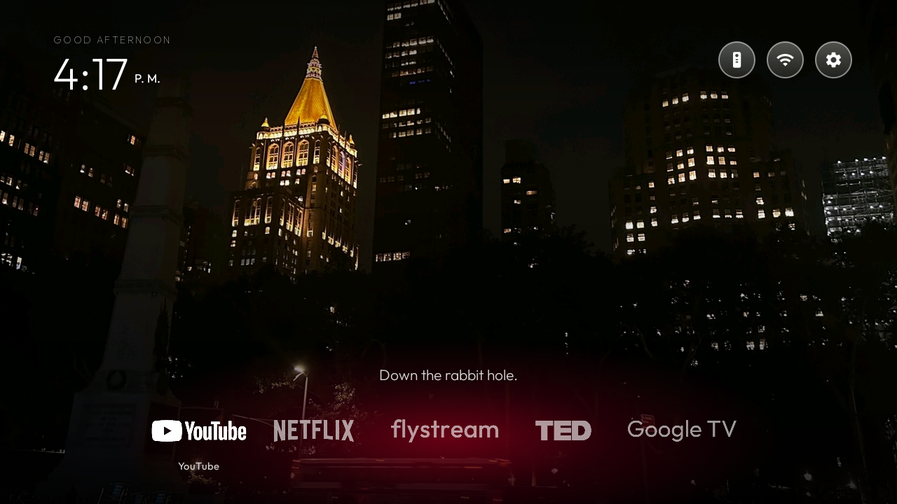
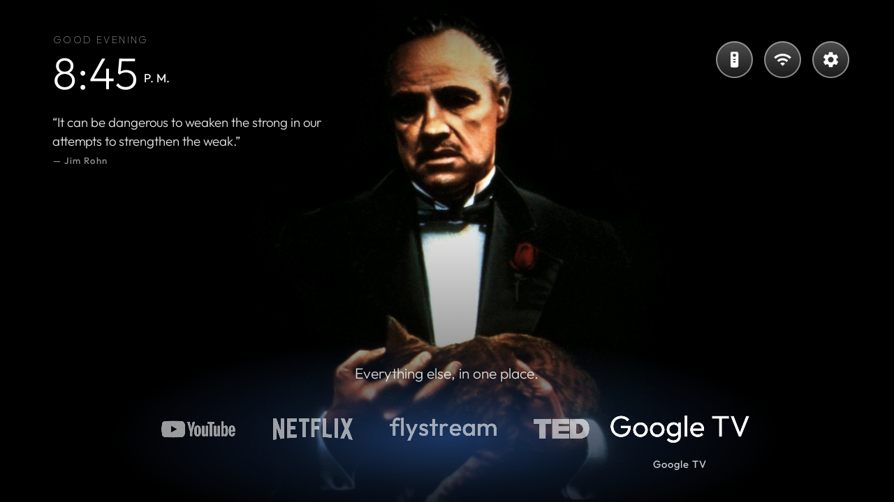
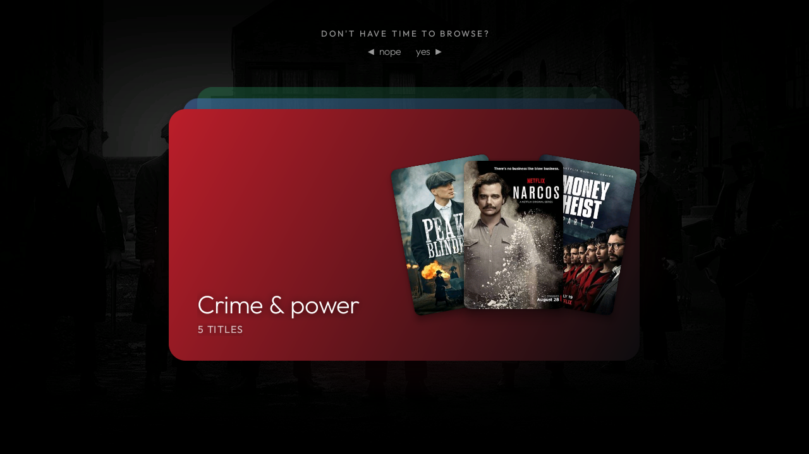

# TV Launcher

A fast, quiet, ad-free Home screen for Android TV / Google TV. It replaces the stock launcher with three pages you move between using only the remote's D-pad:

1. **Home**: clock, greeting, weather, a daily quote and a dock of your apps.
2. **My Favourites**: a lineup of your favourite characters. Pick one and their show opens in Netflix.
3. **Don't have time to browse?**: swipe through mood cards and let a slot-machine reel choose what to watch.

It has **zero dependencies**, only plain Android framework APIs. It was built for a 1 GB RAM TV (Sansui / Expressluck AiPlus2K, Android TV 11), where the stock launcher is slow and full of recommendation rows and ads. Starting this one is near-instant.

| Home | Home with a quote |
|---|---|
|  |  |

| My Favourites | Don't have time to browse? |
|---|---|
|  |  |

---

## How you move around

The pages are stacked vertically. **Down** goes to the next page and **Up** goes back, and the wallpaper gets darker the further down you go.

```
        Home (dock)
            ↓ ↑
      My Favourites
            ↓ ↑
 Don't have time to browse?
```

**Back** returns one page. The Home button always brings you to the dock.

---

## 1. Home

- **Greeting and clock.** "Good morning / afternoon / evening / night" plus an optional name. The clock follows the TV's 12 h or 24 h setting. The greeting switches to Spanish when the TV's language is Spanish.
- **Weather.** A small temperature and icon from [Open-Meteo](https://open-meteo.com) (free, no account or API key). It refreshes at most every 30 minutes, and only while the home screen is showing. Your location is stored as a latitude and longitude on the TV and is never drawn on screen.
- **Daily quote.** One quote a day from a text file you put on the TV. If there's no file, the quote box hides itself.
- **The dock.** White logos for YouTube, Netflix, a web tile, TED and Google TV.
  - Moving the focus makes a soft glow in that brand's colour appear behind the dock, and a short tagline appears above it. The taglines rotate each time you return Home.
  - Apps that aren't installed are hidden automatically.
  - Home lands on the app you used last.
  - The **web tile** opens a full-screen browser. The arrow keys move an on-screen pointer, OK clicks, Back goes back a page. Pop-ups are blocked and a page can't redirect itself to another site.
- **Top-right buttons.** Remote and accessories (Bluetooth), Wi-Fi, and Settings.
- **Morning song (optional).** When the TV wakes up around a time you choose, it opens a YouTube video once that day.
- **Custom wallpaper.** Drop a JPG on the TV and it replaces the built-in one.

## 2. My Favourites

A lineup of four characters stands over the wallpaper in black and white, in two rows:

| Character | Show |
|---|---|
| Tommy Shelby | Peaky Blinders |
| Harvey Specter | Suits |
| Berlin | Money Heist |
| Tanjiro | Demon Slayer |

- Use **Left / Right** to move along the lineup.
- The selected character **turns to colour and grows**. Front-row characters also step forward.
- A **glow in their colour** sits behind them.
- The background **crossfades to a darkened black-and-white scene** from their show.
- The title and character name appear at the top with a Netflix mark.
- **OK** opens that show in Netflix.
- The launcher remembers which one you picked last.
- **Up** goes back Home and **Down** goes to the mood cards.

## 3. "Don't have time to browse?"

For when you just want something good on, now.

A deck of **mood cards** is stacked in the middle of the screen:

| Mood | Examples |
|---|---|
| Crime & power | Peaky Blinders, Money Heist, Narcos, Ozark, Breaking Bad |
| Smart & sharp | Suits, The Queen's Gambit, Mindhunter, Lupin |
| Anime nights | Demon Slayer, One Piece, Cyberpunk: Edgerunners, Castlevania |
| Edge of your seat | Stranger Things, Squid Game, Dark, Black Mirror |
| Laugh it off | Brooklyn Nine-Nine, Wednesday, Sex Education, Never Have I Ever |
| Anything at all | A random pick from every mood |

How it works:

- **Left ("nope")** throws the top card away and reveals the next one.
- **Right ("yes") or OK** spins a **slot-machine reel** through that mood's posters. It slows down and lands on a random title.
- It then counts down **"Opening in 3…"** and opens the title in Netflix.
- During the countdown, **OK** opens it right now, **Right** spins again, and **Left or Back** cancels.

---

## Customising

Everything is in `app/src/main/`.

| What | Where |
|---|---|
| Dock apps, logos, brand colours and taglines | `HomeActivity.java` (`TILES`) |
| Favourite characters, colours and Netflix title IDs | `Favourites.java` (`FAVS`) |
| Mood cards and their titles | `assets/moods/moods.json` |
| Character cut-outs, black-and-white copies and scenes | `assets/fav/` |
| Mood posters and backdrops | `assets/moods/posters/`, `assets/moods/backdrops/` |

A Netflix title ID is the number at the end of a netflix.com/title/... address.

### Personal settings (sent from your computer over ADB)

These are stored on the TV. Nothing about you is hard-coded in the app.

```bash
# Greeting name
adb shell am start -n com.terry.home/.HomeActivity --es name 'Your Name'

# Weather location (latitude / longitude)
adb shell am start -n com.terry.home/.HomeActivity --es lat 40.71 --es lon -74.01

# Morning song: a YouTube link or video id, and the time
adb shell am start -n com.terry.home/.HomeActivity --es song 'https://youtu.be/VIDEOID' --es song_time 07:00
```

### Daily quote and wallpaper

```bash
# One quote per line. End a line with " — Author" to set the author.
adb push quotes.txt /sdcard/Android/data/com.terry.home/files/quotes.txt

# Custom wallpaper
adb push wallpaper.jpg /sdcard/Android/data/com.terry.home/files/wallpaper.jpg
```

---

## Build and install

Requires JDK 17 and the Android SDK (platform 34).

```bash
echo "sdk.dir=/path/to/your/android-sdk" > local.properties
./gradlew assembleDebug
```

On the TV, turn on Developer options and network debugging, then:

```bash
adb connect <tv-ip>:5555
adb install -r app/build/outputs/apk/debug/app-debug.apk

# Lets the launcher repair its own Home-button helper if Android turns it off
adb shell pm grant com.terry.home android.permission.WRITE_SECURE_SETTINGS
```

Press Home and choose this launcher.

### Making the remote's Home button work (Google TV)

Google TV sends the Home button straight to its own launcher and ignores the default-home setting. This app includes a small **accessibility service** (`HomeKeyService`) that only watches for the Home key, swallows it, and opens this launcher instead. Every other key passes through untouched. Turn it on under Settings → Accessibility → "Home button → Home launcher". It never reads the screen or any content.

## Optional: debloat scripts

`debloat.sh` and `restore.sh` remove (and bring back) unwanted system apps such as the ACR viewing tracker, FAST channels and the stock home screen's ad rows. They use `pm uninstall -k --user 0`, so the app files stay on the TV and **everything is reversible** with `./restore.sh`.

They were written for one specific TV. **Read the package list first**, and set your own address:

```bash
export ANDROID_SERIAL=<tv-ip>:5555
./debloat.sh
```

## Privacy

- The only network calls are to Open-Meteo for weather (your coordinates are sent to it) and the pages you choose to open.
- There is no analytics, no account and no tracking.
- Your name, location and morning song live only in the app's private storage on your TV.

## Notes

- The character cut-outs, scenes, posters and backdrops come from TV shows and are included to show how the launcher looks. Replace them with your own images if you redistribute this.
- Netflix, YouTube, TED and Google TV names and logos belong to their owners.
- The Outfit font is under the SIL Open Font License (`app/src/main/assets/fonts/Outfit-OFL.txt`).
